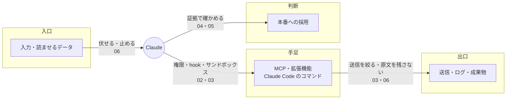

# claude-safe-usage-guide

**A Japanese, practice-oriented guide to using Claude Desktop and Claude Code safely at work.** It organizes the risks into inputs, tools, outputs and decisions, then gives verified settings (permission rules, hooks, sandbox, managed settings), a tested PreToolUse hook that blocks secret-file access and risky commands, review checklists for AI-written code, and kintone-specific review points.
Settings syntax was checked against the official Claude Code documentation on 2026-11-19; anything that could not be verified is marked as such.

[](https://github.com/ikkeiman/claude-safe-usage-guide/actions/workflows/ci.yml)

## これは何か

Claude Desktop と Claude Code を**業務で**使うときに、何が危なく、何をどう設定し、AI が作ったものをどう確かめてから使うかを、一つにまとめたガイドです。

- 約 100 名規模の組織で全職員向けの生成 AI 基盤を設計し、kintone の業務システムを内製してきた経験をもとに、公開情報（公式ドキュメント、開発元の開発者向け記事・セッション、Anthropic の公開記事）で裏付けを取って一般化しました。組織固有のルールは含みません
- 設定のひな形と、危ない操作を止める hook のスクリプト（テスト 53 件）を同梱しています
- 姉妹リポジトリと組み合わせて使えます: 入口で個人情報を止める [llm-guard-gateway](https://github.com/ikkeiman/llm-guard-gateway)、MCP サーバーの安全な作り方 [secure-mcp-server-guide](https://github.com/ikkeiman/secure-mcp-server-guide)、kintone の部品集 [kintone-js-utils](https://github.com/ikkeiman/kintone-js-utils)

## 結論（先に）

**5 つの原則**（[docs/00](docs/00-principles.md)）

1. 目的と条件は人が決め、採用の判断も人がする
2. 権限は最小から始める
3. 漏れる場所を最初から作らない（送らない・置かない・残さない）
4. 入れる前に確かめる（動いた ≠ 正しい）
5. 記録は残すが、原文は残さない

**今日やること 5 つ**

1. 個人情報・社外秘を入力しない。必要なら伏せてから使う（[06](docs/06-sensitive-data.md)）
2. Claude Code で `.env`・鍵を読めなくし、送信と強制 push を止める（[templates/claude-code](templates/claude-code)）
3. macOS / Linux ならサンドボックスを有効にする。`bypassPermissions` は隔離した環境の中だけ（[03](docs/03-claude-code.md)）
4. Claude Desktop の道具は出所と道具の一覧を見てから入れる。「常に許可」は読み取り専用だけ（[02](docs/02-claude-desktop.md)）
5. AI が書いたコードは、説明できて・実在する API で・テストが通るものだけ採用する（[04](docs/04-review-ai-code.md)・[05](docs/05-kintone.md)）



## 目次

| 章 | 内容 |
|---|---|
| [00 原則](docs/00-principles.md) | 5 つの原則と、人と AI の役割分担 |
| [01 脅威](docs/01-threats.md) | 入口・手足・出口・判断の 4 区分で 10 の脅威を整理。守る順番 |
| [02 Claude Desktop](docs/02-claude-desktop.md) | MCP サーバー・拡張機能・コネクタを入れる前と使うときの確認 |
| [03 Claude Code](docs/03-claude-code.md) | 権限モード、allow / ask / deny、hooks、サンドボックス、MCP、GitHub Actions、管理設定 |
| [04 AI が書いたものの確認](docs/04-review-ai-code.md) | Claude Code チームの検証のやり方と、採用までのチェックリスト |
| [05 kintone](docs/05-kintone.md) | AI で作ったカスタマイズのよくあるミス、アンチパターンと置き換え先、セキュリティの観点 |
| [06 個人情報・機密](docs/06-sensitive-data.md) | 送らない・読ませない・残さない |
| [07 組織への導入](docs/07-rollout.md) | 試す → ルール → 仕組み → 広げる → 見直す |
| [チェックリスト](checklists/README.md) | 印刷用の 1 枚もの |

## ひな形

| ファイル | 中身 |
|---|---|
| [templates/claude-code/settings.json](templates/claude-code/settings.json) | プロジェクト用。秘密ファイルの読み取り禁止、送信・強制 push の禁止、公開系は確認、hook とサンドボックス |
| [templates/claude-code/hooks/guard.py](templates/claude-code/hooks/guard.py) | PreToolUse hook。秘密ファイル、`curl \| sh`、`rm -rf /`、`git push --force` などを止め、`git push` や公開は人に確認する。依存なし |
| [templates/claude-code/managed-settings.json](templates/claude-code/managed-settings.json) | 組織で配る管理設定の例。`bypassPermissions` を無効化 |
| [templates/review/REVIEW.md](templates/review/REVIEW.md) | レビューの基準のひな形 |
| [templates/review/CLAUDE.md.snippet](templates/review/CLAUDE.md.snippet) | プロジェクトの CLAUDE.md に足す安全のルール |

```bash
mkdir -p .claude/hooks
cp templates/claude-code/settings.json .claude/settings.json
cp templates/claude-code/hooks/guard.py .claude/hooks/guard.py
```

## 開発

```bash
uv sync --dev
uv run ruff check . && uv run ruff format --check .
uv run pytest -q
```

テストは、hook に実際に JSON を渡して判定を確かめるもの（秘密ファイル、危ないコマンド、確認に回すコマンド、通すべき普通の操作）と、ひな形の JSON が公式ドキュメントで確認した書式に沿っているかを確かめるものです。

## やっていないこと・制約

- **公式の保証ではありません。** 公式ドキュメントで確認した事実をもとにした、個人の実践ガイドです。Claude Code と Claude Desktop は更新が速いので、使う前に公式ドキュメントで確かめてください
- **deny ルールと hook は文字列で判断します。** 言い換えには弱く、悪意のある回避を防ぐ境界ではありません。境界はサンドボックス・コンテナ・VM です
- **ひな形の settings.json を実際の Claude Code に読み込ませた動作確認は、この README を書いた環境ではしていません。** 書式は公式ドキュメントと照合し、hook のスクリプトは単体でテストしています。導入したら `/permissions` で確かめてください
- **Windows のネイティブ環境では Claude Code のサンドボックスが効きません**（公式ドキュメントより）
- kintone の章で引用した cybozu developer network の記事は、この資料を作った環境から本文を直接開けず、**検索結果で API 名と要点を確認**しています。記事本文で確かめてください
- 報道記事（[R1][R2]）は検索結果の要約で内容を確認しています
- Claude Desktop の事実は、姉妹リポジトリ [secure-mcp-server-guide](https://github.com/ikkeiman/secure-mcp-server-guide) で 2026-11-08 に公式ドキュメントから確認したものを使っています
- 監視・ログ収集（OpenTelemetry など）と、データの保存期間・学習への利用の詳細は扱っていません。公式の情報（[C10] からリンクされている規約・プライバシーのページ）を確認してください

## 参考資料（確認日: 2026-11-19）

**Claude Code 公式ドキュメント**（本文を確認）

- [C1] 権限モード https://code.claude.com/docs/en/permission-modes
- [C2] 権限ルール https://code.claude.com/docs/en/permissions
- [C3] 設定ファイルと優先順位 https://code.claude.com/docs/en/settings
- [C4] hooks https://code.claude.com/docs/en/hooks
- [C5] サンドボックス https://code.claude.com/docs/en/sandboxing
- [C6] 開発用コンテナ https://code.claude.com/docs/en/devcontainer （存在のみ確認。手順の詳細は未確認）
- [C7] MCP https://code.claude.com/docs/en/mcp
- [C8] GitHub Actions https://code.claude.com/docs/en/github-actions
- [C9] 管理設定 https://code.claude.com/docs/en/managed-settings 、設定項目の一覧 https://code.claude.com/docs/en/settings-reference
- [C10] セキュリティ https://code.claude.com/docs/en/security

**Claude Desktop・MCP**（2026-11-08 に確認、[secure-mcp-server-guide](https://github.com/ikkeiman/secure-mcp-server-guide) の参考資料を参照）

- [D1] ローカル MCP サーバーの接続 https://modelcontextprotocol.io/docs/develop/connect-local-servers 、https://support.claude.com/en/articles/10949351-getting-started-with-local-mcp-servers-on-claude-desktop
- [D2] デバッグとログ https://modelcontextprotocol.io/docs/tools/debugging
- [D3] MCP Bundle https://claude.com/docs/connectors/building/mcpb
- [D4] Desktop Extensions https://www.anthropic.com/engineering/desktop-extensions
- [D5] カスタムコネクタ https://claude.com/docs/connectors/custom/add-unlisted

**AI が書いたコードの検証**

- [R1] GIGAZINE「Claude Codeチームは検証についてどのように考えて実行しているのか」2026-11-18 https://gigazine.net/news/20261118-claude-code-test-code-review/ （検索結果の要約で確認）
- [R2] InfoQ "Anthropic Outlines its AI-Powered Code Review Process for Claude Code" 2026-11 https://www.infoq.com/news/2026/11/claude-code-review/ （検索結果の要約で確認）
- [R3] Anthropic "Code Review is now generally available" 2026-10-15 https://claude.com/resources/articles/code-review-is-now-generally-available （本文を確認）

**kintone**（cybozu developer network。検索結果で API 名と要点を確認）

- [K0] kintone の開発元による、AI で作ったカスタマイズの確認についての開発者向けセッション（2026 年。作者が入手した書き起こしをもとに要点を整理）
- [K1] 生成AIを利用したkintoneカスタマイズの注意点とレビュー観点 https://cybozu.dev/ja/kintone/ai/generative-ai-customize-review-points/
- [K2] AI 駆動開発の基本 https://cybozu.dev/ja/kintone/ai/kintone-ai-development-basics/
- [K3] MCPサーバーでAI x kintoneカスタマイズ開発の信頼性を高めよう https://cybozu.dev/ja/kintone/ai/reliable-kintone-customization-with-mcp/
- [K4] フィールドのスタイルを設定する https://cybozu.dev/ja/kintone/docs/js-api/record/set-field-style/
- [K5] レコードの一覧（表形式）のスタイルを設定する https://cybozu.dev/ja/kintone/docs/js-api/app/set-record-list-style/ 、アンチパターンから学ぶ 条件書式の実装（一覧画面）https://cybozu.dev/ja/kintone/tips/development/anti-pattern/implement-record-list-conditional-format/
- [K6] フィールドの表示／非表示を切り替える https://cybozu.dev/ja/kintone/docs/js-api/record/show-or-hide-a-field
- [K7] 確認ダイアログ https://cybozu.dev/ja/kintone/docs/js-api/kintone/show-confirm-dialog/ 、通知 https://cybozu.dev/ja/kintone/docs/js-api/kintone/show-notification/ 、アンチパターンから学ぶ ダイアログや通知バナーの実装 https://cybozu.dev/ja/kintone/tips/development/anti-pattern/implement-dialog/
- [K8] レコードのアクセス権を評価する https://cybozu.dev/ja/kintone/docs/rest-api/records/evaluate-record-permissions
- [K9] クエリの書き方 https://cybozu.dev/ja/kintone/docs/overview/query/
- [K10] アンチパターンから学ぶ 外部APIの実行 https://cybozu.dev/ja/kintone/tips/development/anti-pattern/external-api-integration/ 、kintone.proxy https://cybozu.dev/ja/kintone/docs/js-api/proxy/kintone-proxy/ 、kintone.plugin.app.proxy https://cybozu.dev/ja/kintone/docs/js-api/plugins/kintone-plug-in-proxy/

**作者の公開リポジトリ**

- [O1] [llm-guard-gateway](https://github.com/ikkeiman/llm-guard-gateway) — 入口で個人情報を止めるプロキシと評価
- [O2] [secure-mcp-server-guide](https://github.com/ikkeiman/secure-mcp-server-guide) — MCP サーバーの安全な作り方
- [O3] [kintone-js-utils](https://github.com/ikkeiman/kintone-js-utils) — kintone カスタマイズの部品集
- [O4] [kintone-dropbox-plugin](https://github.com/ikkeiman/kintone-dropbox-plugin) — 秘密をブラウザに出さない kintone プラグイン

## ライセンス

MIT
