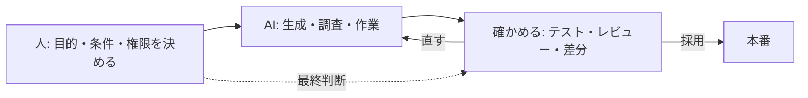

# 00. 原則 — 5 つだけ覚える

この資料のすべての設定例とチェックリストは、次の 5 つの原則から出てきます。迷ったらここに戻ってください。

| # | 原則 | ひとことで | 主な章 |
|---|---|---|---|
| P1 | **目的と条件は人が決め、採用の判断も人がする** | AI は提案と作業、判断は人 | [04](04-review-ai-code.md)・[05](05-kintone.md) |
| P2 | **権限は最小から始める** | 許可は足し算、禁止は最初から | [02](02-claude-desktop.md)・[03](03-claude-code.md) |
| P3 | **漏れる場所を最初から作らない** | 送らない・置かない・残さない | [06](06-sensitive-data.md) |
| P4 | **入れる前に確かめる** | 動いた ≠ 正しい。証拠で判断する | [04](04-review-ai-code.md) |
| P5 | **記録は残すが、原文は残さない** | 何が起きたかは追えるが、ログが機密の置き場にならない | [06](06-sensitive-data.md)・[07](07-rollout.md) |

## P1. 目的と条件は人が決め、採用の判断も人がする

生成 AI は「それらしく動くもの」を一瞬で作れます。だからこそ、**中身を見ないまま本番に入れてしまう**ことが一番起きやすい事故です。
kintone の開発元のセッションや開発者向け記事でも、「目的と条件を人が決める → AI に依頼する → 人と AI で確認する → 採用か修正かを人が判断する」という流れを繰り返すことが示されています（[05](05-kintone.md)、参考資料 [K1][K2]）。
Claude Code の開発チーム自身も、作業の結果を「証拠に基づいて」確かめる仕組みを重ねています（[04](04-review-ai-code.md)、参考資料 [R1][R2]）。

## P2. 権限は最小から始める

Claude Desktop の MCP サーバーも Claude Code も、**あなたのユーザー権限で動く**プログラムを動かします。
許可は「必要になったら足す」、危ない操作（秘密ファイルの読み取り、外部への送信、削除、本番への反映）は「最初から禁止」にしておきます。
承認ボタンは最後の砦であって、唯一の防御にしてはいけません。何十回も押すうちに流れ作業になるからです。

## P3. 漏れる場所を最初から作らない

- 個人情報や社外秘を**送らない**（入力の前に止める・伏せる）
- API トークンやパスワードを**置かない**（コード・設定・ブラウザ・チャットに書かない）
- 本文や検索語を**残さない**（ログに原文を書かない）

後から守るより、守る対象を増やさない設計の方が確実です。

## P4. 入れる前に確かめる

「動いた」は「正しい」ではありません。AI が書いたコードは、存在しない API、古い書き方、フィールドの取り違え、権限の考慮漏れを含むことがあります。
テスト・差分・レビュー・小さな範囲での試行という**証拠**を見てから採用します。

## P5. 記録は残すが、原文は残さない

何が起きたか（いつ・誰が・どの操作を・許可したか拒否したか）は追えるようにします。
ただし、プロンプトやファイルの本文そのものをログに残すと、ログ自体が機密の置き場所になります。種類・件数・ハッシュなど、**中身を含まない形**で残します。
