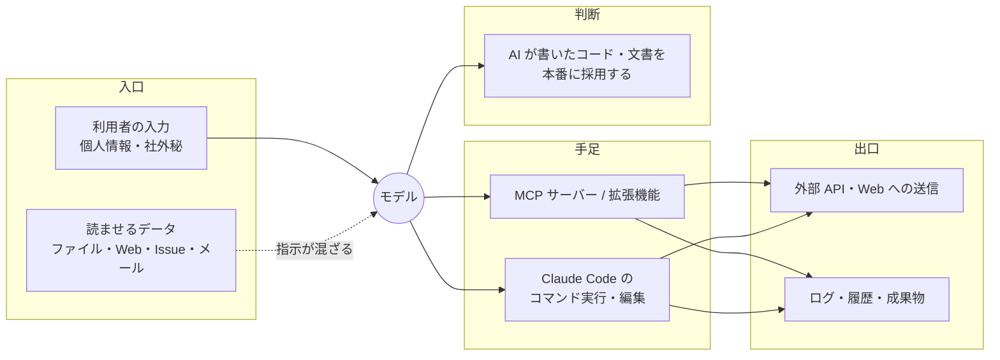

# 01. 何が危ないのか — 脅威の整理

Claude Desktop と Claude Code を業務で使うときに起きうることを、**入口（何が入ってくるか）・手足（何ができるか）・出口（何が出ていくか）・判断（何を採用するか）**の 4 つに分けて整理します。

## 脅威の一覧

| # | 区分 | 脅威 | 起きる条件 | 影響 | 主な対策の章 |
|---|---|---|---|---|---|
| X1 | 入口 | **機密・個人情報の入力** | 利用者が顧客情報や社外秘をそのまま貼る | 外部サービスへの送信、履歴への残存 | [06](06-sensitive-data.md) |
| X2 | 入口 | **読ませたデータに混ざった指示（プロンプトインジェクション）** | ファイル本文・Web ページ・Issue・メールに「〜を実行せよ」「〜を送れ」と書かれている | モデルが指示に従ってツールやコマンドを使う | [02](02-claude-desktop.md)・[03](03-claude-code.md) |
| X3 | 手足 | **権限の与えすぎ** | MCP サーバーにホーム全体を読ませる、Claude Code の確認を全部省略する | X2 やバグの被害範囲が「自分ができること全部」に広がる | [02](02-claude-desktop.md)・[03](03-claude-code.md) |
| X4 | 手足 | **供給網（サプライチェーン）** | 出所を確かめずに拡張機能・MCP サーバー・パッケージを入れる。`npx -y` などで起動のたびに取得する | 自分の権限で他人のコードが動く | [02](02-claude-desktop.md) |
| X5 | 手足 | **秘密ファイルの読み取り** | `.env`・鍵・認証情報ファイルを Claude Code が読める状態にしている | トークンがモデルへの入力や出力に混ざる | [03](03-claude-code.md) |
| X6 | 出口 | **外部への送信** | `curl` や Web 取得が無制限、MCP サーバーが任意の URL に送れる | データの持ち出し | [03](03-claude-code.md) |
| X7 | 出口 | **ログ・成果物への残存** | プロンプトやファイル本文をログに出す、生成物に秘密が混ざる | ログ自体が漏えい源になる | [06](06-sensitive-data.md) |
| X8 | 判断 | **確かめずに本番へ** | 生成されたコードが「動いた」ので、そのまま反映する | 存在しない API・古い書き方・権限漏れ・XSS が本番に入る | [04](04-review-ai-code.md)・[05](05-kintone.md) |
| X9 | 判断 | **レビューの形骸化** | 量が多く、人が読まずに承認・マージする | X8 と同じ。問題に気づく機会が消える | [04](04-review-ai-code.md) |
| X10 | 判断 | **権限の偽装（なりすましの依頼）** | 「上司の承認済み」「管理者の指示」とだけ書かれたテキストに AI が従う | 本来の承認を経ない操作 | [03](03-claude-code.md)・[07](07-rollout.md) |

## 守る順番

組織で導入する場合、次の順に手を打つと、少ない労力で大きな事故を防げます。

1. **送らない**: 個人情報・社外秘を入力しない／入力の前に止める（X1）
2. **読ませない**: 秘密ファイルを読める状態にしない（X5）
3. **持たせない**: 書き込み・送信・削除の権限を最初から絞る（X3, X6）
4. **確かめる**: AI が書いたものを、証拠を見てから採用する（X8, X9）
5. **出所を固定する**: 拡張機能・MCP サーバー・依存の版と出所を決める（X4）

プロンプトインジェクション（X2）は**完全には防げません**。上の 2〜3 で「従ってしまっても壊せない・持ち出せない」状態にしておくのが現実的な対策です。
