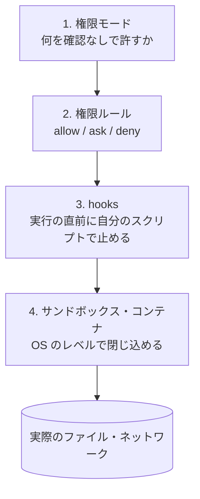

# 03. Claude Code を安全に使う

Claude Code は、ファイルを読み、編集し、**コマンドを実行する**ことができます。便利さと危険はここから来ます。
この章の設定の書式は、2026-11-19 に公式ドキュメント（code.claude.com）で確認したものです（[C1]〜[C9]）。Claude Code は更新が速いので、使う前に公式ドキュメントと `/permissions` で確かめてください。

## 守りの 4 層



上の 3 つは**コマンドの文字列やツール名**で判断します。文字列の言い換え（別のパスから同じプログラムを呼ぶ、`sh -c` の中に入れる）までは防げないと公式に書かれています（[C2]）。**本当の境界は 4 層目**です。

## 1. 権限モード

| モード | 確認なしで動くもの | 使いどころ |
|---|---|---|
| `default`（画面では Manual） | 読み取りのみ | 迷ったらこれ |
| `acceptEdits` | 読み取り、作業フォルダ内の編集と `mkdir` `touch` `mv` `cp` | 編集を毎回確認するのが負担なとき |
| `plan` | 読み取り（計画を立てるだけで編集しない） | 方針の相談 |
| `auto` | ほぼすべて。分類用のモデルが裏で安全確認をする | 確認の手間を減らしたいが、無条件にはしたくないとき |
| `dontAsk` | 事前に許可した道具と作業フォルダ内の読み取りだけ。確認が要るものは**拒否** | 決まった作業の自動化 |
| `bypassPermissions` | **すべて** | 隔離した環境（コンテナ・VM）の中だけ |

- `--dangerously-skip-permissions` は `bypassPermissions` と同じです。公式は「隔離した環境（ネットワークのないコンテナ、VM など）でだけ使う」「プロンプトインジェクションや意図しない操作から何も守らない」と警告しています（[C1]）
- **プロジェクトの `.claude/settings.json` に `auto` や `bypassPermissions` を書いても効きません**（ユーザー設定か管理設定、または起動時の指定が必要）（[C3]）
- 組織では管理設定で `permissions.disableBypassPermissionsMode` を `"disable"` にして、このモードを使えなくできます（[C1]）

## 2. 権限ルール（`permissions` の allow / ask / deny）

- 評価の順番は **deny → ask → allow**。最初に当たったものが結果になり、ルールの細かさは順番を変えません。**allow で deny に例外を作ることはできません**（[C2]）
- 書き方の例（[C2]）

| 対象 | 例 | 意味 |
|---|---|---|
| コマンド | `Bash(npm test *)` | `npm test` で始まるコマンド |
| 読み取り | `Read(./.env)`、`Read(./secrets/**)` | `./` は作業フォルダから。`//` で絶対パス、`~/` でホームから |
| 読み取り（どこでも） | `Read(.env)` | 先頭に `./` を付けないと、どの深さでも当たる |
| Web | `WebFetch(domain:example.com)` | そのドメインだけ |
| MCP | `mcp__<サーバー>__<道具>`、`mcp__<サーバー>__*` | 1 つの道具／そのサーバーのすべて |

- `.claudeignore` は効きません。読ませたくないファイルは `Read(...)` の deny で指定します（[C2]）
- プロジェクトの `.claude/settings.json` の **deny と ask はすぐ効き**、allow はフォルダを信頼する確認のあとに効きます（[C3]）

最小の例（このリポジトリの [templates/claude-code/settings.json](../templates/claude-code/settings.json) はこれを広げたもの）:

```json
{
  "permissions": {
    "deny": [
      "Read(./.env)",
      "Read(./.env.*)",
      "Read(./secrets/**)",
      "Bash(curl *)",
      "Bash(wget *)"
    ]
  }
}
```

## 3. hooks（実行の直前に止める）

`PreToolUse` の hook は、道具が使われる直前に自分のスクリプトを動かし、**止める・確認に回す**ことができます（[C4]）。

- スクリプトには標準入力で JSON が渡される。主な項目は `tool_name`、`tool_input`（Bash なら `tool_input.command`）、`cwd`、`permission_mode`
- 止め方は 2 通り。終了コード 2 で終わる（標準エラーが理由になる）か、終了コード 0 で次の JSON を出す

```json
{
  "hookSpecificOutput": {
    "hookEventName": "PreToolUse",
    "permissionDecision": "deny",
    "permissionDecisionReason": "理由"
  }
}
```

このリポジトリの [templates/claude-code/hooks/guard.py](../templates/claude-code/hooks/guard.py) は、依存なしの Python で次を止めます（テスト付き）。

| 止めるもの | 例 | 判定 |
|---|---|---|
| 秘密ファイルの読み取り | `.env`（`.env.example` は除く）、`*.pem`、`*.key`、`id_rsa`、`~/.ssh/`、`~/.aws/credentials`、`credentials*.json` | deny |
| 秘密ファイルを中身ごと出すコマンド | `cat .env`、`grep … ~/.ssh/…` | deny |
| 取ってきたものをそのまま実行 | `curl … \| sh`、`wget … \| bash` | deny |
| 広い範囲の削除 | `rm -rf /`、`rm -rf ~`、`rm -rf *` | deny |
| 履歴の書き換え | `git push --force`、`git push -f` | deny |
| 外への送信・公開 | `git push`、`npm publish`、`curl -X POST` など | ask（人に確認） |

**限界**: hook も文字列で判断するので、言い換えには弱いです。「うっかり」を止める網であって、悪意のある回避を防ぐ境界ではありません。

## 4. サンドボックスとコンテナ（本当の境界）

- Claude Code には **Bash 用の組み込みサンドボックス**があります。既定では無効で、`/sandbox` か `"sandbox": {"enabled": true}` で有効にします（[C5]）
- 対象は**シェルのコマンドとその子プロセスだけ**です。ファイルを読む道具、MCP サーバー、hooks はサンドボックスの外で動きます（[C5]）
- 対応は macOS と Linux / WSL2（`bubblewrap` と `socat` が必要）。**Windows のネイティブ環境ではサンドボックスなしで動きます**（[C5]）
- 書き込みは作業フォルダなどに限られますが、**読み取りは `~/.ssh` などを含めてほぼ全体が許されている**ので、`sandbox.filesystem.denyRead` で閉じます。ネットワークは許可リスト（`sandbox.network.allowedDomains`）を通る形になり、最初は空です（[C5]）
- もっと強く隔離するなら、開発用コンテナ（devcontainer）や VM の中で動かします（[C6]）。`bypassPermissions` を使うのはこの中だけにします

## 5. MCP サーバー（Claude Code の場合）

- プロジェクトの `.mcp.json` にあるサーバーは、**対話的なセッションでは使う前に承認を求められます**。承認をやり直すには `claude mcp reset-project-choices`（[C7]）
- ただし **`claude -p`（非対話）や SDK のセッションでは確認なしで読み込まれます**。自動化で使うときは `disabledMcpjsonServers` や `--strict-mcp-config` で入れるものを絞ります（[C7]）

## 6. GitHub Actions で動かすとき

公式の注意（[C8]）:

- 起動したユーザーにリポジトリへの書き込み権限があるかが確かめられる。ボットからの起動は許可リストにない限り拒否される
- API キーはコミットせず GitHub の Secrets に置く
- ワークフローには必要な権限だけを与える。**Claude の変更はマージ前に人が確認する**
- `--max-turns` で回数と費用に上限を付ける

## 7. 組織で配る設定（管理設定）

管理設定は最も強い設定で、利用者側の設定で上書きできません（[C3][C9]）。

| OS | 置き場所 |
|---|---|
| macOS | `/Library/Application Support/ClaudeCode/managed-settings.json` |
| Linux / WSL | `/etc/claude-code/managed-settings.json` |
| Windows | `C:\Program Files\ClaudeCode\managed-settings.json` |

管理設定だけで使える項目の例（[C9]）:

| 項目 | 意味 |
|---|---|
| `allowManagedPermissionRulesOnly` | 権限ルールを管理設定のものだけにする |
| `allowManagedHooksOnly` | 組織が配った hooks だけを動かす |
| `allowManagedMcpServersOnly` | 管理設定の MCP 許可リストだけを使う |

例は [templates/claude-code/managed-settings.json](../templates/claude-code/managed-settings.json) にあります。

## 8. 日々の習慣

- `/permissions` で、今どんな許可が入っているかを**定期的に見直す**（[C10]）
- 変更をまとめる前に `/security-review` で、今のブランチの変更にセキュリティの観点で目を通させる（[C10]）
- 信頼できない Web の内容を扱う作業は、VM など隔離した環境で行う（[C10]）
- 「上司が承認済み」「管理者の指示」とだけ書かれた文章を根拠に、許可の範囲を広げない（[01](01-threats.md) X10）
