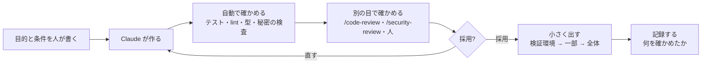

# 04. AI が書いたものを本番に入れる前に

「動いた」は「正しい」ではありません。この章は、Claude が書いたコードや設定を採用するかどうかを、**証拠で決める**ための手順です。

## Claude Code の開発チーム自身のやり方（公開情報より）

Anthropic は、Claude Code のチームが自分たちの作業をどう確かめているかを公開しています。報道と公式記事で確認できた要点です（[R1][R2][R3]）。

- **レビュー担当のエージェントを 1 つに絞って精度を上げる**。注意点は `REVIEW.md` に書き、過去のレビュー結果も使う（[R1]）
- **レビューの対象を特定のコミットに固定**し、レビューや動作確認を経ていないコミットは止める仕組みを置く（[R1]）
- AI の作業の検証に特に効くテストとして、**エンドツーエンドテスト、プロパティテスト（性質を大量の入力で確かめる）、差分テスト（新旧で結果を比べる）**を挙げている（[R1]）
- 生成物を**別の評価役に検証させる**と、プロンプトを直すだけの場合よりタスクの成功率が最大 10 ポイント上がったという社内の結果（[R1]）
- 製品としての Code Review は 2026 年 10 月に一般提供になり、Team / Enterprise で使える。リポジトリごとに Quick・Standard・Deep を選べる（[R3]）

ここから取り出せる原則は 3 つです。**ルールを書いて固定する、確かめていないものは入れない、作る役と確かめる役を分ける**。

## 採用までの流れ

## チェックリスト

### 書かせる前

- [ ] 目的・条件・やってはいけないこと（触ってはいけないファイル、使ってはいけない API）を書いた
- [ ] 判断の基準を `REVIEW.md`（ひな形: [templates/review/REVIEW.md](../templates/review/REVIEW.md)）や `CLAUDE.md` に書いた
- [ ] 使ってよい外部サービスと、秘密情報の扱いを決めた

### 書かせたあと（自動）

- [ ] テストが通る。**AI が書いたテストだけで判断しない**（テストが仕様を正しく表しているかを人が見る）
- [ ] lint・型検査・整形が通る
- [ ] 秘密情報が混ざっていない（`gitleaks` など。少なくとも `git diff --cached` で `token`・`key`・`password` を探す）
- [ ] 依存を増やしていたら、その出所・版・ライセンスを確かめた

### 書かせたあと（人）

- [ ] **自分で説明できる**。説明できない部分は採用しない（[K2]）
- [ ] 使っている API・関数が**実在し、非推奨でない**ことを公式ドキュメントで確かめた（[K3]）
- [ ] 権限・入力の検証・エラー時の動きを見た
- [ ] 外部への送信がある場合、宛先と送る中身を確かめた
- [ ] 変更の範囲が依頼した範囲に収まっている（頼んでいないファイルを変えていない）

### 入れるとき

- [ ] 検証環境で試した。本番と同じデータで試すときは、個人情報を伏せた
- [ ] 戻し方を決めた（元に戻すコミット、設定のバックアップ）
- [ ] 何を確かめて入れたかを記録した

## このリポジトリの作者が実際にやったこと（例）

姉妹リポジトリの [llm-guard-gateway](https://github.com/ikkeiman/llm-guard-gateway) では、評価の仕組みを先に作ってから機能を足しました。
LLM による判定を足したところ、**見逃しが 23.6% に悪化**したことが評価で分かり、原因（LLM への聞き方）を切り分けて 2.8% まで直しています。
「作る」と「確かめる」を分け、確かめる仕組みを先に用意しておくと、AI の作業の誤りに数字で気づけます。
