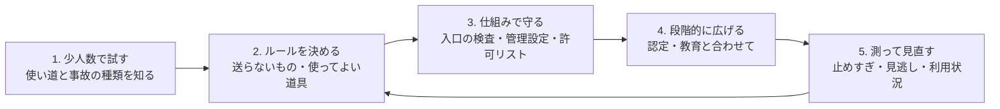

# 07. 組織に入れるとき

技術の設定より時間がかかるのは、**ルール・人・運用**です。約 100 名規模の組織で全職員向けの生成 AI 基盤を設計した経験から、一般化した進め方をまとめます（組織固有のルールは含みません）。

## 段階

## それぞれで決めること

| 段階 | 決めること | 対応する章 |
|---|---|---|
| 1. 試す | 誰が・何の業務で・どのデータで試すか。架空のデータから始める | [06](06-sensitive-data.md) |
| 2. ルール | 送らない情報の区分、使ってよい拡張機能・MCP サーバー・コネクタ、AI が書いたコードを入れる前の確認 | [02](02-claude-desktop.md)・[04](04-review-ai-code.md) |
| 3. 仕組み | 入口での検査（伏せる・止める）、Claude Code の管理設定（`bypassPermissions` を無効にする、deny ルールを配る）、拡張機能の許可リスト | [03](03-claude-code.md) |
| 4. 広げる | 基本の使い方と、作る人向けの使い方を分けて教える。作る人には確認の手順を必須にする | [04](04-review-ai-code.md)・[05](05-kintone.md) |
| 5. 見直す | 止めすぎ（現場の不満）と見逃し（事故の種）の両方を数える。ルールを緩める変更は別の人が承認する | [00](00-principles.md) |

## うまくいくための考え方

- **止めすぎも失敗**として数える。止めすぎると、現場は隠れて使い始めます
- **どこまで許すかは業務側が決める**。技術の役割は、その判断材料を数字で出すこと
- **ルールを緩める変更は、決めた人とは別の人が承認する**
- 「AI がこう言ったから」を根拠にしない。採用の判断と責任は人が持つ（[00](00-principles.md) P1）
